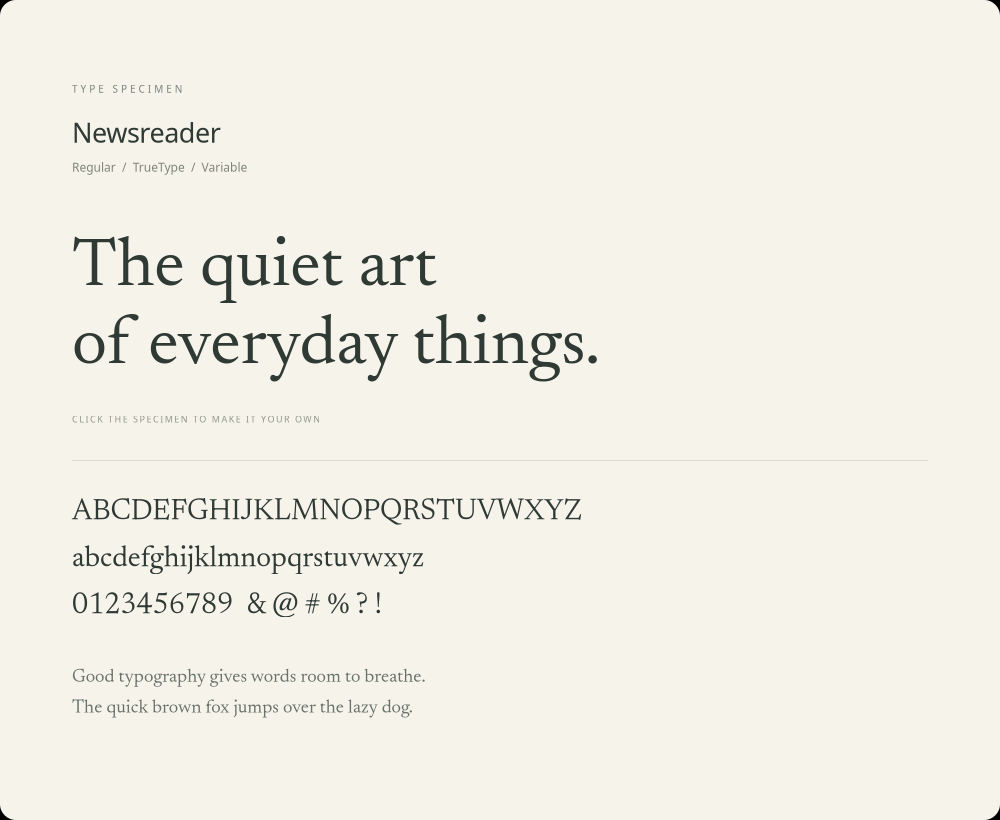
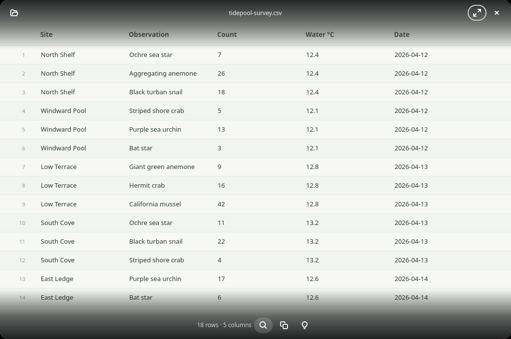
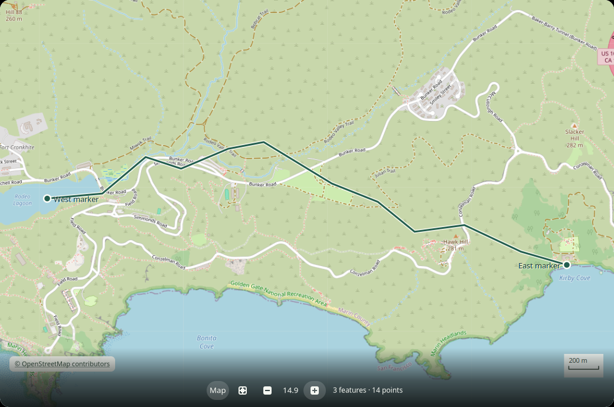

# Zen Viewers

**Minimalist, modern viewers for Linux.**

Zen Viewers brings the quiet, focused feel of tablet apps to the Linux desktop. Open a file and let the content fill the window, with rounded corners and controls that fade in at the top or bottom edge.

Built in C with a shared GTK 4 shell, each viewer stays small and focused. Separate renderer packages let you install just the viewers you need.

| App | Current functionality |
| --- | --- |
| **zen-pdf** | Fit-width pages, smooth vertical scrolling, animated page turns, an optional page sidebar, zoom and text selection |
| **zen-image** | Folder navigation, fast camera RAW previews, image details, fit, pan, zoom and rotation |
| **zen-markdown** | Serif reading view, formatted tables, selectable text, links, font sizing and source view |
| **zen-3d** | GPU mesh and point-cloud viewing, orbit, pan, zoom, view presets and optional model details |
| **zen-video** | Local playback, hover timeline, seeking, frame stepping, volume and subtitles |
| **zen-books** | Reflowable EPUB, CBZ comic pages, contents, night mode and saved reading position |
| **zen-font** | Spacious font specimens, editable sample text, glyph browsing and variable axes |
| **zen-table** | CSV, TSV and Parquet browsing with searchable rows and copyable values |
| **zen-map** | GPX, KML and GeoJSON viewing with an optional live OpenStreetMap basemap |

The nine viewers share a GTK 4 window shell linked into each executable. Each app keeps its format-specific dependencies in its own package.

## Screenshots

Actual app windows. Click an image for the full-size screenshot.

| Zen PDF | Zen Image |
| --- | --- |
| [](previews/pdf-hover.png) | [](previews/image-hover.png) |
| **Zen Markdown** | **Zen 3D** |
| [](previews/markdown-hover.png) | [](previews/3d-hover.png) |
| **Zen Video** | **Zen Books** |
| [](previews/video-hover.png) | [](previews/books-hover.png) |

| Zen Font | Zen Table | Zen Map |
| --- | --- | --- |
| [](previews/font.png) | [](previews/table.png) | [](previews/map.png) |

Map tiles © [OpenStreetMap contributors](https://www.openstreetmap.org/copyright).

With the controls hidden. [PDF](previews/pdf-quiet.png) · [Image](previews/image-quiet.png) · [Markdown](previews/markdown-quiet.png) · [3D](previews/3d-quiet.png) · [Video](previews/video-quiet.png) · [Books](previews/books-quiet.png).

## Build

These commands build all nine apps on Ubuntu 22.04 or later.

```sh
sudo apt install build-essential cmake pkg-config libgtk-4-dev libpoppler-glib-dev libcmark-gfm-dev libcmark-gfm-extensions-dev libexif-dev libraw-dev libepoxy-dev libassimp-dev libmpv-dev libarchive-dev libxml2-dev libfontconfig-dev libfreetype-dev libcurl4-gnutls-dev libjson-glib-dev libzstd-dev zlib1g-dev liblz4-dev libbrotli-dev
make
```

Run the executables from `build/`.

```sh
build/zen-pdf examples/field-notes.pdf
build/zen-image examples/basin.png
build/zen-markdown examples/welcome.md
build/zen-3d examples/trefoil.glb
build/zen-video examples/basin.webm
build/zen-books examples/above-the-fog.epub
build/zen-font /usr/share/fonts/truetype/dejavu/DejaVuSerif.ttf
build/zen-table examples/tidepool-survey.csv
build/zen-map examples/headlands-sketch.geojson
```

Running an app without a filename opens its start screen. All apps support **Ctrl+O**, file drag-and-drop, **Ctrl+W**, and **F11**. Hover near the top for the filename, open, fullscreen and close buttons. Hover near the bottom for reading or viewing controls. **Tab** makes the controls available from the keyboard. Drag an unclaimed part of the top area to move a window or drag an edge to resize it.

Each app also has an individual build target.

```sh
make zen-image       # GTK and system image loaders, optional LibRaw and libexif
make zen-pdf         # GTK + Poppler
make zen-markdown    # GTK + cmark-gfm
make zen-3d          # GTK + libepoxy + Assimp
make zen-video       # GTK + libepoxy + libmpv
make zen-books       # GTK + libarchive + libxml2
make zen-font        # GTK + Fontconfig + FreeType + PangoFT2
make zen-table       # GTK + bundled C Parquet reader + system compression libraries
make zen-map         # GTK + libcurl + libxml2 + JSON-GLib
```

Only the chosen target's development dependencies are needed. Libexif adds JPEG camera and exposure details. Install `fonts-noto-core` on Ubuntu for Markdown's preferred Noto Serif typeface. Run `zen-image --formats` to list your system's image formats and see the [image README](apps/zen-image/README.md) for optional loaders. See the [packaging notes](packaging/README.md) for Fedora dependencies.

Zen Table reads all three formats in native code. Its pinned Carquet source is included in the repository, and builds use system zstd, zlib, LZ4 and Brotli libraries. Zen Map draws local tracks without a connection. Press **M** to toggle the live basemap.

The viewer executables and their build steps do not invoke Python. Some optional developer tests use Python to generate fixtures and drive test windows.

## Linux portability

The suite targets GTK 4.6 and GLib 2.72 or later. Packages have been built and installed on Ubuntu 22.04, Ubuntu 26.04 and Fedora 43 on x86-64. The shared shell uses GDK for X11 and Wayland window operations and works independently of GNOME or KDE libraries. Automated window tests run under X11 with Xvfb.

Zen 3D and Zen Video use desktop OpenGL 3.3 through standard GTK, libepoxy and libmpv APIs. Mesa provides hardware and software implementations. Other viewers use GTK rendering.

Build a package on the target distribution, release and CPU architecture so its shared-library requirements match that system. ARM64, 32-bit and musl builds still need validation.

## Window corners

Zen normally draws 16 px corners for floating windows. In Niri, it hands the window shape to the compositor to avoid two overlapping curves. With Niri's `clip-to-geometry true` already set, your existing rule applies. This rule scopes the setting to the Zen apps.

```kdl
window-rule {
    match app-id=r#"^io\.github\.(zenpdf|zenimage|zenmap|zenviewers\.(Markdown|ThreeD|Video|Books|Font|Table))$"#
    geometry-corner-radius 8
    clip-to-geometry true
}
```

Use your preferred radius. On other compositors that clip windows, launch the viewer with `ZEN_CORNERS=system` to disable Zen's rounding. Use `ZEN_CORNERS=rounded` to force Zen's corners in windowed mode. [Niri window rules](https://github.com/niri-wm/niri/wiki/Configuration%3A-Window-Rules)

## Install and packages

```sh
make install PREFIX="$HOME/.local"
```

Make sure `$HOME/.local/bin` is on the desktop session's `PATH`. For a system installation use `sudo make install`. To install just one app, add `APPS=zen-image` (or another app name). Use the same `PREFIX` and `APPS` values with `make uninstall` to remove it.

Debian and Ubuntu package builds require `dpkg-dev`.

```sh
sudo apt install dpkg-dev
./scripts/build-deb.sh
sudo apt install ./dist/*_"$(cat VERSION)"-1_*.deb
```

The default build creates one package per app and a small `zen-viewers` metapackage that installs all nine. To package one viewer, use `./scripts/build-deb.sh --app zen-table` with its app name. The builder detects linked runtime dependencies from each executable. Build on the target distribution and architecture or an older compatible baseline.

See [packaging notes](packaging/README.md) for RPM builds and release details.

## PDF selection and copy

Drag starting on text to select across lines. Double-click a word or triple-click a line. **Ctrl+A** selects the current page's text, **Ctrl+C** or **Ctrl+Insert** copies it, and **Esc** clears the selection. Completing a selection also supplies the Linux PRIMARY clipboard for middle-paste in another app.

Use the wheel or touchpad to scroll across pages. The left and right arrows slide between pages, and **Ctrl+B** toggles the page sidebar. Drag blank page space to pan. **Ctrl+drag** or middle-drag pans over text. Zoom, scrolling and window resizing preserve selection alignment. Image-only scans need an embedded OCR text layer for selection. Text extraction stays on a worker, and selection changes do not rerender the PDF.

See the controls for [PDF](apps/zen-pdf/README.md), [Image](apps/zen-image/README.md), [Markdown](apps/zen-markdown/README.md), [3D](apps/zen-3d/README.md), [Video](apps/zen-video/README.md), and [Books](apps/zen-books/README.md).

See [Font](apps/zen-font/README.md), [Table](apps/zen-table/README.md), and [Map](apps/zen-map/README.md) for their controls and file formats.

## Structure

```text
common/                 Window, hover overlays, open/drop, fullscreen, feedback
apps/zen-pdf/           Poppler rendering, textured pages, navigation and selection
apps/zen-image/         Image decoding, folder navigation, details and view controls
apps/zen-markdown/      Markdown parsing, native text styles, links and tables
apps/zen-3d/            Assimp import, OpenGL rendering and orbit camera
apps/zen-video/         libmpv playback, OpenGL presentation and timeline
apps/zen-books/         EPUB reflow, comic pages and saved reading state
apps/zen-font/          Local font specimens, glyphs and variable axes
apps/zen-table/         Indexed delimited text and paged Parquet browsing
apps/zen-map/           Geographic file parsing, map canvas and tile caching
examples/               Small original files to try
previews/               Actual app screenshots, with and without controls
scripts/                Package builders
packaging/              RPM spec and package documentation
```

[Architecture and adding a viewer](common/README.md)

## Verification

```sh
make check
make check-data
ZEN_PDF_BIN="$PWD/build/zen-pdf" apps/zen-pdf/tests/smoke.sh
```

`make check` runs native checks and fixed data fixtures without Python. `make check-data` adds developer fixture-generation tests using Python and, for additional Parquet cases, PyArrow.

The optional native-window tests use `xvfb xauth xdotool xclip dbus-daemon python3-pil`, a WebP loader, and FFmpeg for generating video fixtures. Zen Font's smoke test uses DejaVu Serif.

```sh
make check-ui
```

They verify rendered pixels and viewer interactions under Xvfb. The map tests use a local tile server to check loading and caching.

## Prototype boundaries

- PDF rendering runs on a Poppler worker. GTK presents cached page textures during scrolling and page turns. The sidebar shows the document outline when available and lists pages otherwise.
- Images are still frames. Large inputs request a preview of at most 32 megapixels/16,384 pixels per axis, and compressed file input is limited to 128 MiB. Loader-specific memory use can exceed the preview size. Rotation applies to the view only.
- Markdown supports CommonMark with the GitHub-style table extension. Images appear as alt-text links and raw HTML appears as text. It reads UTF-8 files up to 8 MiB and bounds nesting, node count and formatting spans.
- Zen 3D opens static geometry such as OBJ, GLB, STL and PLY. It requires desktop OpenGL 3.3. Supported extensions depend on the installed Assimp build.
- Rounded transparency depends on the compositor. A noncomposited X11 desktop can show opaque corner backgrounds.

## License

GPL-3.0-or-later. See [LICENSE](LICENSE). Linked libraries retain their own licenses.
